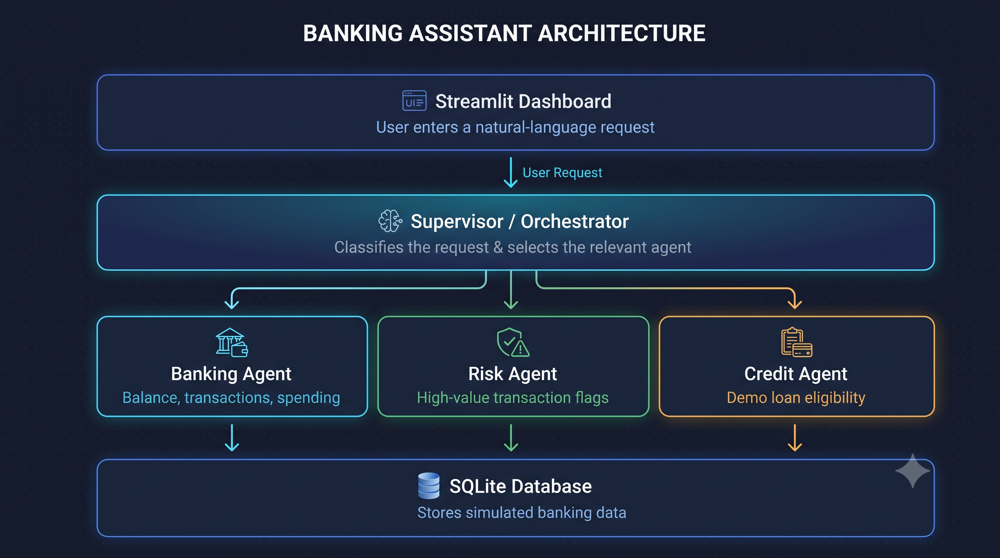

# Multi-Agent Banking Simulation

A simulated banking application built with Python, Streamlit, SQLite, and Google's Gemini API. It uses a supervisor to route natural-language requests to specialized agents for banking operations, risk monitoring, and loan eligibility assessment.

## Features

- **Account Balance:** View the customer's simulated account balance.
- **Recent Transactions:** Review recent credits and debits.
- **Spending Analysis:** Analyze debit transactions by category.
- **Risk Monitoring:** Flag high-value debit transactions for review.
- **Loan Eligibility:** Evaluate demo eligibility using configured income and credit-score criteria.
- **AI Assistant:** Enter natural-language requests and route them to the appropriate agent.

## Architecture

- **Streamlit UI (`app.py`):** Dashboard and interactive AI assistant.
- **Supervisor (`agents/supervisor.py`):** Coordinates request classification and agent execution.
- **Banking Agent (`agents/banking_agent.py`):** Balance, transaction, and spending queries.
- **Risk Agent (`agents/risk_agent.py`):** Flags high-value debit transactions.
- **Credit Agent (`agents/credit_agent.py`):** Applies demo loan eligibility criteria.
- **LLM Service (`services/llm_service.py`):** Classifies natural-language requests using rules and Gemini.
- **SQLite (`database/`):** Stores simulated customer, account, transaction, and loan data.

## Architecture Diagram



The Supervisor coordinates incoming requests and routes them to the Banking, Risk, or Credit Agent. These agents process simulated banking data stored in SQLite. Gemini provides fallback classification for requests that local rules do not recognize.

## Requirements

- Python 3.10 or later
- A Google Gemini API key for AI-based classification of requests not recognized by the local rules

## Setup

1. Clone the repository:

   ```bash
   git clone https://github.com/mexmegha21/Banking-multi-agent-mvp.git
   cd Banking-multi-agent-mvp
   ```

2. Create and activate a virtual environment:

   **Windows PowerShell**
   ```powershell
   python -m venv .venv
   .venv\Scripts\Activate.ps1
   ```

   **macOS/Linux**
   ```bash
   python -m venv .venv
   source .venv/bin/activate
   ```

3. Install dependencies:

   ```bash
   pip install -r requirements.txt
   ```

4. Create a `.env` file in the project root and add your own Gemini API key:

   ```env
   GEMINI_API_KEY=your_gemini_api_key_here
   ```

   Replace the placeholder with your key. Do not commit or share the `.env` file.

## Run the Application

From the project root, run:

```bash
streamlit run app.py
```

Streamlit will provide a local URL, usually `http://localhost:8501`, to open the dashboard in your browser.

## Run Tests

Run the available test files from the project root:

```bash
python -m unittest discover -v
```

If the test files use standalone execution rather than `unittest`, run them individually as needed, for example:

```bash
python test_banking.py
python test_risk.py
python test_credit.py
python test_llm.py
python test_supervisor.py
```

## Safety and Limitations

- This is an educational simulation using sample data; it is not connected to a real bank.
- High-value transactions are flagged for review and are not automatically confirmed as fraud.
- Loan eligibility is based on simplified demonstration criteria and is not a real loan approval.
- Keep API keys private and never commit secrets to GitHub.

## Technology Stack

Python · Streamlit · SQLite · Pandas · Google Gemini API
